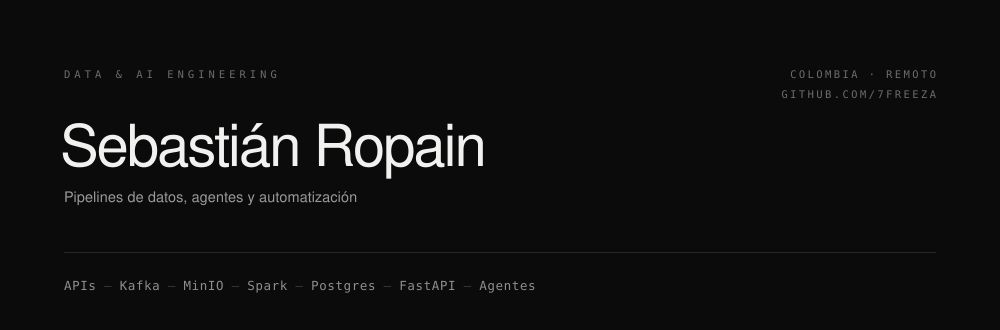

  

Construyo sistemas de datos de punta a punta: ingesta orquestada, capas limpias y auditables, API y consumo en vivo. El criterio que repito en todos mis proyectos es el mismo: **el dato llega con calidad o no llega, y el agente que lo consulta no inventa.**

## Superficie técnica

| Capa | Stack | Qué hago con eso |
|:--|:--|:--|
| **Ingesta y orquestación** | Apache Airflow · Apache Kafka (KRaft) · Python | DAGs disparados por Dataset, backfill parametrizado, reintentos con backoff, topics con retención y DLQ. |
| **Procesamiento** | Apache Spark · SQL | Batch y Structured Streaming con event-time, watermarking, checkpoints y deduplicación por clave natural. |
| **Almacenamiento** | PostgreSQL 16 · MinIO / S3 · JSONB | Medallion `raw` → `staging` → `curated`, lake funcional y roles con privilegios por schema. |
| **Serving** | FastAPI · SQLAlchemy · Pydantic · JWT + RBAC · SSE | API tipada, streaming en vivo y permisos `viewer` / `admin` sin atajos. |
| **IA aplicada** | RAG · embeddings · Ollama · Gemini · sqlglot | NL-to-SQL de solo lectura validado por AST, reportes con validador numérico, traducción local. |
| **Operación** | Docker / Compose · Linux · Git · pytest · bandit · n8n | Stack de 6 servicios en un compose, 44 tests automatizados y SAST en el pipeline. |

## Principios de trabajo

1. **Idempotencia antes que velocidad.** Upsert por clave natural, reproceso sin duplicar, backfill parametrizado. Si correr el DAG dos veces rompe algo, el diseño está mal.
2. **La calidad es una compuerta, no un reporte.** El registro que no pasa la regla no llega a la capa de consumo, y su motivo de rechazo queda registrado.
3. **IA con freno.** El LLM redacta o traduce; los números los calcula SQL y un validador los contrasta. Un reporte con cifras inventadas es un bug, no un detalle.
4. **Local por defecto.** Ollama y almacenamiento propio cuando el dato no debe salir de la máquina; proveedor externo solo como fallback explícito.

## Trabajo seleccionado

### [SismoWatch](https://github.com/7Freeza/SismoWatch) — monitoreo sísmico global en tiempo casi real
`PYTHON` · `AIRFLOW` · `POSTGRESQL` · `FASTAPI` · `SSE` · `OLLAMA` · `SQLGLOT`

El feed del USGS se actualiza cada minuto y no sirve para decidir nada: nadie sabe si el dato está limpio, si el pipeline corrió o de dónde salió una cifra. SismoWatch lo convierte en un producto auditable en cinco minutos de ciclo.

- Ingesta cada 5 min en Airflow, con el payload HTTP íntegro guardado en `raw` para reprocesar sin volver a la fuente.
- Medallion `raw` → `staging` → `curated` en PostgreSQL 16: upsert por `id`, compuerta bloqueante de 20 % de rechazo y métricas de calidad por lote.
- Anomalías por `z-score` sobre ventana de 7 días y reporte diario con `qwen2.5:3b`, validado contra los números del SQL.
- API con rol `api_reader` de solo lectura, JWT + RBAC, SSE para el tablero y agente NL-to-SQL validado con `sqlglot`.
- 44 tests (Airflow + API) y escaneo `bandit` versionado en `docs/bandit.txt`.

### [lambda-crypto-platform](https://github.com/4ndr3s-00/lambda-crypto-platform) — batch y streaming sin pisarse
`KAFKA` · `SPARK` · `MINIO` · `AIRFLOW` · `FASTAPI`

Proyecto en equipo. Dos rutas de cómputo escribiendo el mismo mercado: si no hay regla de precedencia, el número que ve el usuario depende del orden de llegada.

- Lambda puro sobre Kafka KRaft: topics, particiones, retención y DLQ declarados en `infra/`.
- Speed layer con Spark Structured Streaming, ventanas por event-time, watermarking y checkpoints durables.
- Batch layer en Airflow + Spark para recálculo histórico idempotente; MinIO organizado por función (`historical/`, `batch-results/`, `checkpoints/`, `quarantine/`).
- Serving que reconcilia por marca temporal de evento y deduplica antes de exponer.

### Otros

| Proyecto | Problema | Decisión técnica |
|:--|:--|:--|
| **[cuadre-iq](https://github.com/7Freeza/cuadre-iq)** | Facturas en PDF o foto que no cuadran contra el libro. | PyMuPDF + RapidOCR, motor de reglas propio, reconciliación y confirmación humana. Todo local. |
| **[feedbackiq-app](https://github.com/7Freeza/feedbackiq-app)** | Costos de token sin control en un flujo de feedback multilingüe. | Conteo exacto con tokenizer `o200k`, traducción ES→EN local con CTranslate2 y analítica de ahorro por modelo. |
| **[IQ-Academy-Chatbot](https://github.com/7Freeza/IQ-Academy-Chatbot)** | Academia de idiomas sin atención fuera de horario. | RAG con embeddings locales, streaming y fallback a Gemini API. |

También en el historial: [T7-Dotfiles](https://github.com/7Freeza/T7-Dotfiles) (ricing de Linux en Niri, 6★) y [Terminal---Souls](https://github.com/7Freeza/Terminal---Souls) (juego por turnos en Python).

## Métricas

<table>
  <tr>
    <td width="50%" valign="top">
      
    </td>
    <td width="50%" valign="top">
      
    </td>
  </tr>
  <tr>
    <td colspan="2" align="center">
      
    </td>
  </tr>
</table>

---

  Abierto a roles de Data Engineering / AI Engineering · remoto o Colombia 
  <a href="mailto:ropainsebastian0@gmail.com">ropainsebastian0@gmail.com</a> · <a href="https://github.com/7Freeza">github.com/7Freeza</a>

